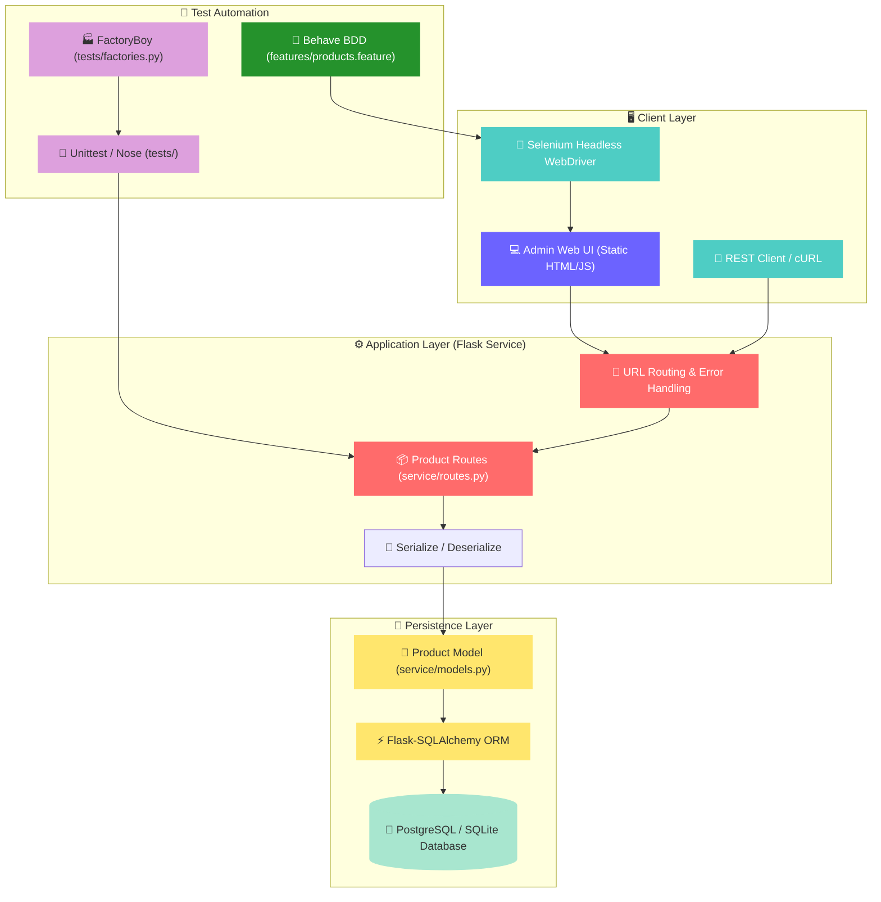
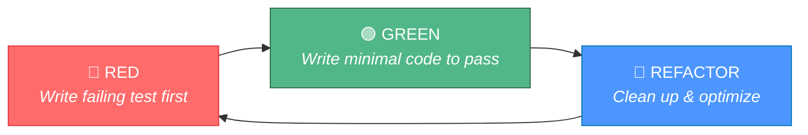

<!-- ═══════════════════════════════════════════════════════════════════════════ -->
<!-- 🎨  HEADER BANNER — SVG-based hero with gradient feel                    -->
<!-- ═══════════════════════════════════════════════════════════════════════════ -->

<div align="center">

<!-- Animated typing SVG as a hero title -->
<a href="https://github.com/Sairaj213/tdd-bdd-final-project">
  
</a>

<br/>

<!-- Subtle tagline -->


<br/><br/>

<!-- ── Badges Row 1: Project Metadata ── -->


<br/>

<!-- ── Badges Row 2: Technologies & QA ── -->


<br/>

<!-- ── Divider ── -->


</div>

<br/>

<!-- ═══════════════════════════════════════════════════════════════════════════ -->
<!-- 📑  TABLE OF CONTENTS                                                     -->
<!-- ═══════════════════════════════════════════════════════════════════════════ -->

## 📑 Table of Contents

<details open>
<summary><b>Click to expand / collapse</b></summary>

<br/>

| # | Section | Description |
|:-:|:--------|:------------|
| 1 | [🎯 Project Overview](#-project-overview) | Mission, learning objectives, and scope |
| 2 | [⚡ Key Features](#-key-features) | CRUD, search filters, and UI capabilities |
| 3 | [🏗️ Architecture & Workflows](#️-architecture--workflows) | System design, TDD cycle, and pipeline |
| 4 | [📡 RESTful API Specifications](#-restful-api-specifications) | Endpoint table with request/response schemas |
| 5 | [🗄️ Data Model](#️-data-model) | SQLAlchemy schema and Category enumeration |
| 6 | [🧪 Test-Driven Development (TDD)](#-test-driven-development-tdd) | Unit tests, FactoryBoy fakes, and coverage |
| 7 | [🥒 Behavior-Driven Development (BDD)](#-behavior-driven-development-bdd) | Gherkin scenarios with Behave and Selenium |
| 8 | [📊 Test Coverage & Metrics](#-test-coverage--metrics) | 97%+ automated test verification report |
| 9 | [📂 Repository Structure](#-repository-structure) | Complete directory and file walkthrough |
| 10 | [🚀 Getting Started](#-getting-started) | Installation, environment setup, and running |
| 11 | [🤝 Contributing](#-contributing) | Contribution guidelines |
| 12 | [📜 License](#-license) | License information |

</details>

<br/>

<!-- ═══════════════════════════════════════════════════════════════════════════ -->
<!-- 🎯  PROJECT OVERVIEW                                                      -->
<!-- ═══════════════════════════════════════════════════════════════════════════ -->

## 🎯 Project Overview

> **This repository contains the complete microservice implementation for an e-Commerce Product Catalog back-end**, rigorously developed using **Test-Driven Development (TDD)** and verified using **Behavior-Driven Development (BDD)**.

Product administrators manage inventory via a dedicated administrative Web UI, which communicates with a RESTful Flask service connected to a relational database through SQLAlchemy ORM.

### 🧩 What This Project Demonstrates

```
┌─────────────────────────────────────────────────────────────────────────────┐
│                                                                             │
│   ✅  Test-Driven Development (TDD): Red-Green-Refactor unit test suite     │
│       covering 100% of routes and models (97% total codebase coverage)      │
│                                                                             │
│   ✅  Behavior-Driven Development (BDD): Automated UI acceptance tests       │
│       with Gherkin syntax, Behave, and Selenium WebDriver                   │
│                                                                             │
│   ✅  RESTful API Design: Standard HTTP verbs (GET, POST, PUT, DELETE)      │
│       with predictable status codes (200, 201, 204, 400, 404, 415)          │
│                                                                             │
│   ✅  Dynamic Filtering: Multi-parameter query routing by Name,            │
│       Category enum, and Availability boolean status                        │
│                                                                             │
│   ✅  Realistic Mocking: FactoryBoy & Faker generators for reproducible     │
│       synthetic data fixtures                                               │
│                                                                             │
│   ✅  Containerization & 12-Factor Design: Dockerfile, Procfile,            │
│       and DevContainer readiness                                            │
│                                                                             │
└─────────────────────────────────────────────────────────────────────────────┘
```

<br/>

<!-- ═══════════════════════════════════════════════════════════════════════════ -->
<!-- ⚡  KEY FEATURES                                                          -->
<!-- ═══════════════════════════════════════════════════════════════════════════ -->

## ⚡ Key Features

<table>
<tr>
<td width="50%">

### 🛍️ RESTful Operations

| Feature | Description |
|:---|:---|
| ➕ **Create Product** | Insert new products with strict validation |
| 📖 **Read Product** | Fetch single item details by ID |
| ✏️ **Update Product** | Modify fields on existing products |
| 🗑️ **Delete Product** | Idempotent removal of catalog records |
| 📋 **List All** | Retrieve all stored inventory items |
| 🔍 **Filter by Name** | Exact name substring and word matches |
| 🏷️ **Filter by Category** | Categorize by CLOTHS, FOOD, TOOLS, etc. |
| 🟢 **Filter by Availability** | Query in-stock (`True`) or out-of-stock |

</td>
<td width="50%">

### 🧪 Reliability & Quality Assurance

| Capability | Implementation |
|:---|:---|
| 🔴🟢 **TDD Red-Green-Refactor** | 31 comprehensive unit tests |
| 🎯 **97% Code Coverage** | Exceeds the strict 95% pass criteria |
| 🎭 **Faker & FactoryBoy** | Random choice, fuzzy decimals, and text |
| 🥒 **7 Automated BDD Scenarios** | Full browser workflow via Selenium |
| 🛡️ **Exception Handlers** | Uniform JSON error responses |
| 📦 **SQLAlchemy ORM** | Schema validation, enums, & decimal math |
| 🩺 **Health Check Endpoint** | Instant uptime verification (`/health`) |

</td>
</tr>
</table>

<br/>

<!-- ═══════════════════════════════════════════════════════════════════════════ -->
<!-- 🏗️  ARCHITECTURE & WORKFLOWS                                             -->
<!-- ═══════════════════════════════════════════════════════════════════════════ -->

## 🏗️ Architecture & Workflows

### 🌐 System Architecture



<br/>

### 🔄 The TDD Red-Green-Refactor Cycle



<br/>

<!-- ═══════════════════════════════════════════════════════════════════════════ -->
<!-- 📡  RESTFUL API SPECIFICATIONS                                            -->
<!-- ═══════════════════════════════════════════════════════════════════════════ -->

## 📡 RESTful API Specifications

| Verb | Path | Status | Request Body | Response Body | Description |
|:---:|:---|:---:|:---:|:---:|:---|
| `GET` | `/health` | `200 OK` | — | `{"status": 200, "message": "OK"}` | Healthcheck probe |
| `GET` | `/` | `200 OK` | — | HTML | Administrative Web UI |
| `POST` | `/products` | `201 CREATED` | JSON `{name, desc, price, avail, category}` | JSON with generated `id` | Create a new product |
| `GET` | `/products/<id>` | `200 OK` | — | JSON product object | Retrieve product by ID |
| `PUT` | `/products/<id>` | `200 OK` | JSON with modified fields | Updated JSON product | Update existing product |
| `DELETE` | `/products/<id>` | `204 NO CONTENT` | — | Empty body | Remove product by ID |
| `GET` | `/products` | `200 OK` | — | `[ {product}, ... ]` | List all catalog products |
| `GET` | `/products?name=<name>` | `200 OK` | — | Filtered list | Filter products by name |
| `GET` | `/products?category=<cat>` | `200 OK` | — | Filtered list | Filter products by Category enum |
| `GET` | `/products?available=<bool>`| `200 OK` | — | Filtered list | Filter products by in-stock status |

<br/>

<!-- ═══════════════════════════════════════════════════════════════════════════ -->
<!-- 🗄️  DATA MODEL                                                            -->
<!-- ═══════════════════════════════════════════════════════════════════════════ -->

## 🗄️ Data Model

The `Product` database entity is managed through SQLAlchemy ORM in [`service/models.py`](service/models.py):

| Attribute | Type | Nullable | Description / Default |
|:---|:---:|:---:|:---|
| `id` | `Integer` | ❌ `False` | Primary Key, autoincrementing unique identifier |
| `name` | `String(100)` | ❌ `False` | Product title (e.g., `"Fedora"`, `"Hammer"`) |
| `description` | `String(250)` | ❌ `False` | Detailed specifications or descriptive text |
| `price` | `Numeric` | ❌ `False` | Precise monetary value stored as Decimal |
| `available` | `Boolean` | ❌ `False` | In-stock indicator (defaults to `True`) |
| `category` | `Enum(Category)` | ❌ `False` | Valid product category (defaults to `UNKNOWN`) |

#### Supported Product Categories:
`Category.UNKNOWN` (0) • `Category.CLOTHS` (1) • `Category.FOOD` (2) • `Category.HOUSEWARES` (3) • `Category.AUTOMOTIVE` (4) • `Category.TOOLS` (5)

<br/>

<!-- ═══════════════════════════════════════════════════════════════════════════ -->
<!-- 🧪  TEST-DRIVEN DEVELOPMENT (TDD)                                         -->
<!-- ═══════════════════════════════════════════════════════════════════════════ -->

## 🧪 Test-Driven Development (TDD)

Every feature in this service was built by writing unit test cases **before** writing implementation code.

### 🏭 Synthetic Data Generation with FactoryBoy
[`tests/factories.py`](tests/factories.py) provides random data fixtures using Faker and Fuzzy providers:

```python
class ProductFactory(factory.Factory):
    """Creates fake products for testing"""
    class Meta:
        model = Product

    id = factory.Sequence(lambda n: n)
    name = FuzzyChoice(choices=["Hat", "Pants", "Shirt", "Apple", "Banana", "Pots", "Towels", "Ford", "Chevy", "Hammer", "Wrench"])
    description = factory.Faker("text")
    price = FuzzyDecimal(0.5, 2000.0, 2)
    available = FuzzyChoice(choices=[True, False])
    category = FuzzyChoice(choices=[Category.UNKNOWN, Category.CLOTHS, Category.FOOD, Category.HOUSEWARES, Category.AUTOMOTIVE, Category.TOOLS])
```

### 🔬 Test Suites Overview
- **Model Tests ([`tests/test_models.py`](tests/test_models.py))**:
  - `test_create_a_product`, `test_read_a_product`, `test_update_a_product`, `test_delete_a_product`, `test_list_all_products`
  - `test_find_by_name`, `test_find_by_category`, `test_find_by_availability`, `test_find_by_price`
  - Deserialization edge cases & type error handling
- **Route Tests ([`tests/test_routes.py`](tests/test_routes.py))**:
  - `test_index`, `test_health`, `test_create_product`, `test_get_product`, `test_get_product_not_found`
  - `test_update_product`, `test_update_product_not_found`, `test_delete_product`, `test_get_product_list`
  - `test_query_by_name`, `test_query_by_category`, `test_query_by_availability`
  - Bad Content-Type and payload validation handling

<br/>

<!-- ═══════════════════════════════════════════════════════════════════════════ -->
<!-- 🥒  BEHAVIOR-DRIVEN DEVELOPMENT (BDD)                                     -->
<!-- ═══════════════════════════════════════════════════════════════════════════ -->

## 🥒 Behavior-Driven Development (BDD)

BDD tests validate the system from the outside-in using **Gherkin feature files**, **Selenium WebDriver**, and **Behave**.

### 🌟 All 7 Verified UI Scenarios

<details>
<summary><b>📖 Scenario 1: Read a Product</b></summary>

```gherkin
Scenario: Read a Product
    When I visit the "Home Page"
    And I set the "Name" to "Hat"
    And I press the "Search" button
    Then I should see the message "Success"
    When I copy the "Id" field
    And I press the "Clear" button
    And I paste the "Id" field
    And I press the "Retrieve" button
    Then I should see the message "Success"
    And I should see "Hat" in the "Name" field
    And I should see "A red fedora" in the "Description" field
    And I should see "True" in the "Available" dropdown
    And I should see "Cloths" in the "Category" dropdown
    And I should see "59.95" in the "Price" field
```
</details>

<details>
<summary><b>✏️ Scenario 2: Update a Product</b></summary>

```gherkin
Scenario: Update a Product
    When I visit the "Home Page"
    And I set the "Name" to "Hat"
    And I press the "Search" button
    Then I should see the message "Success"
    And I should see "A red fedora" in the "Description" field
    When I change "Name" to "Fedora"
    And I press the "Update" button
    Then I should see the message "Success"
    When I copy the "Id" field
    And I press the "Clear" button
    And I paste the "Id" field
    And I press the "Retrieve" button
    Then I should see the message "Success"
    And I should see "Fedora" in the "Name" field
    When I press the "Clear" button
    And I press the "Search" button
    Then I should see the message "Success"
    And I should see "Fedora" in the results
    And I should not see "Hat" in the results
```
</details>

<details>
<summary><b>🗑️ Scenario 3: Delete a Product</b></summary>

```gherkin
Scenario: Delete a Product
    When I visit the "Home Page"
    And I set the "Name" to "Hat"
    And I press the "Search" button
    Then I should see the message "Success"
    And I should see "A red fedora" in the "Description" field
    When I copy the "Id" field
    And I press the "Clear" button
    And I paste the "Id" field
    And I press the "Delete" button
    Then I should see the message "Product has been Deleted!"
    When I press the "Clear" button
    And I press the "Search" button
    Then I should see the message "Success"
    And I should not see "Hat" in the results
```
</details>

<details>
<summary><b>📋 Scenario 4: List all products</b></summary>

```gherkin
Scenario: List all products
    When I visit the "Home Page"
    And I press the "Clear" button
    And I press the "Search" button
    Then I should see the message "Success"
    And I should see "Hat" in the results
    And I should see "Shoes" in the results
    And I should see "Big Mac" in the results
    And I should see "Sheets" in the results
```
</details>

<details>
<summary><b>🍔 Scenario 5: Search by category</b></summary>

```gherkin
Scenario: Search by category
    When I visit the "Home Page"
    And I press the "Clear" button
    And I select "Food" in the "Category" dropdown
    And I press the "Search" button
    Then I should see the message "Success"
    And I should see "Big Mac" in the results
    And I should not see "Hat" in the results
    And I should not see "Shoes" in the results
    And I should not see "Sheets" in the results
```
</details>

<details>
<summary><b>🟢 Scenario 6: Search by available</b></summary>

```gherkin
Scenario: Search by available
    When I visit the "Home Page"
    And I press the "Clear" button
    And I select "True" in the "Available" dropdown
    And I press the "Search" button
    Then I should see the message "Success"
    And I should see "Hat" in the results
    And I should see "Big Mac" in the results
    And I should see "Sheets" in the results
    And I should not see "Shoes" in the results
```
</details>

<details>
<summary><b>🔍 Scenario 7: Search by name</b></summary>

```gherkin
Scenario: Search by name
    When I visit the "Home Page"
    And I set the "Name" to "Hat"
    And I press the "Search" button
    Then I should see the message "Success"
    And I should see "Hat" in the "Name" field
    And I should see "A red fedora" in the "Description" field
```
</details>

<br/>

<!-- ═══════════════════════════════════════════════════════════════════════════ -->
<!-- 📊  TEST COVERAGE & METRICS                                               -->
<!-- ═══════════════════════════════════════════════════════════════════════════ -->

## 📊 Test Coverage & Metrics

Automated test execution using `coverage.py` demonstrates enterprise-grade test verification:

```text
Name                               Stmts   Miss  Cover   Missing
----------------------------------------------------------------
service/__init__.py                   18      3    83%   53-56
service/common/__init__.py             2      0   100%
service/common/cli_commands.py         7      0   100%
service/common/error_handlers.py      32      6    81%   59-61, 89-91
service/common/log_handlers.py        11      1    91%   36
service/common/status.py              63      0   100%
service/config.py                      7      0   100%
service/models.py                     91      0   100%   🏆 Fully Covered
service/routes.py                     81      0   100%   🏆 Fully Covered
----------------------------------------------------------------
TOTAL                                312     10    97%   🚀 Exceeds 95% Target
```

<br/>

<!-- ═══════════════════════════════════════════════════════════════════════════ -->
<!-- 📂  REPOSITORY STRUCTURE                                                  -->
<!-- ═══════════════════════════════════════════════════════════════════════════ -->

## 📂 Repository Structure

```
tdd-bdd-final-project/
│
├── 📁 .devcontainer/               # VSCode DevContainer configurations
├── 📁 bin/
│   └── 📄 setup.sh                 # Environment bootstrapping script
│
├── 📁 features/                    # Behavior-Driven Development (BDD)
│   ├── 📄 environment.py           # Behave hooks, Selenium driver lifecycle
│   ├── 📄 products.feature         # Gherkin scenarios (CRUD + searches)
│   └── 📁 steps/
│       ├── 📄 load_steps.py        # Background database seeding via REST API
│       └── 📄 web_steps.py         # Selenium UI step definitions
│
├── 📁 service/                     # Application Package
│   ├── 📄 __init__.py              # Flask app factory and DB initialization
│   ├── 📄 config.py                # Environment configuration settings
│   ├── 📄 models.py                # Product model & Category enumeration
│   ├── 📄 routes.py                # RESTful API route controllers
│   ├── 📁 common/                  # Error handlers, loggers, HTTP status codes
│   └── 📁 static/                  # Admin single-page frontend (HTML/CSS/JS)
│
├── 📁 tests/                       # Test-Driven Development (TDD)
│   ├── 📄 factories.py             # FactoryBoy mock data generators
│   ├── 📄 test_models.py           # Unit tests for database models
│   └── 📄 test_routes.py           # Unit tests for REST API endpoints
│
├── 🐳 Dockerfile                   # Production container definition
├── 📄 Makefile                     # Common tasks (test, lint, run)
├── 📄 Procfile                     # Honcho process orchestration
├── 📄 requirements.txt             # Pinned Python package dependencies
├── 📄 setup.cfg                    # Flake8 and Nose tool configuration
└── 📄 README.md                    # Project documentation (you are here!)
```

<br/>

<!-- ═══════════════════════════════════════════════════════════════════════════ -->
<!-- 🚀  GETTING STARTED                                                       -->
<!-- ═══════════════════════════════════════════════════════════════════════════ -->

## 🚀 Getting Started

### 1️⃣ Clone the Repository
```bash
git clone https://github.com/Sairaj213/tdd-bdd-final-project.git
cd tdd-bdd-final-project
```

### 2️⃣ Initialize Environment
In the provided Linux / Docker development container:
```bash
bash bin/setup.sh
exit
```
*(Open a fresh terminal to activate the Python virtual environment).*

### 3️⃣ Running the Application
Start the Flask microservice and background dependencies:
```bash
honcho start
```
The administrative UI will be accessible in your browser at `http://localhost:8000`.

### 4️⃣ Running the TDD Unit Tests
Execute the entire test suite and inspect test coverage:
```bash
nosetests -v --with-spec --spec-color
coverage report -m
```

### 5️⃣ Running the BDD Acceptance Tests
Run the automated Selenium browser test scenarios:
```bash
behave
```

### 6️⃣ Code Quality & Linting
Validate formatting and lint compliance:
```bash
make lint
# Or run flake8 / pylint directly:
flake8 service tests features
pylint service tests features
```

<br/>

<!-- ═══════════════════════════════════════════════════════════════════════════ -->
<!-- 🤝  CONTRIBUTING                                                          -->
<!-- ═══════════════════════════════════════════════════════════════════════════ -->

## 🤝 Contributing

Contributions, bug reports, and suggestions are welcome!

1. **🍴 Fork** this repository
2. **🌿 Create a Branch** (`git checkout -b feature/awesome-improvement`)
3. **🧪 Write Tests First** following TDD principles (Red $\rightarrow$ Green $\rightarrow$ Refactor)
4. **💾 Commit Changes** (`git commit -m 'feat: implement awesome improvement'`)
5. **📤 Push to Remote** (`git push origin feature/awesome-improvement`)
6. **🔃 Open a Pull Request**

<br/>

<!-- ═══════════════════════════════════════════════════════════════════════════ -->
<!-- 📜  LICENSE & ACKNOWLEDGMENTS                                             -->
<!-- ═══════════════════════════════════════════════════════════════════════════ -->

## 📜 License

- Licensed under the **Apache License 2.0**. See [`LICENSE`](LICENSE) for details.

<br/>

<!-- ═══════════════════════════════════════════════════════════════════════════ -->
<!-- FOOTER                                                                    -->
<!-- ═══════════════════════════════════════════════════════════════════════════ -->

<div align="center">


<br/>

**⭐ If you found this project helpful, please give it a star on GitHub!**

<br/>

Made with ❤️ by [Sairaj213](https://github.com/Sairaj213)

<br/>

[](https://github.com/Sairaj213)
[](https://github.com/Sairaj213/tdd-bdd-final-project)

</div>
